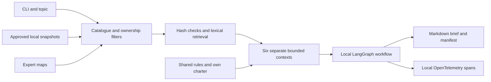

# Architecture

The product is a terminal-operated research council with Markdown output. There is no web UI or application server. The current executable stage prepares expert inputs; live research and discussion are planned.

## Six distinct experts

| Expert ID | Focus |
| --- | --- |
| `technology-evolution` | Components, recombination, dependencies, readiness, and technological trajectories |
| `sexual-selection` | Mate choice, preferences, displays, and limits of applying those explanations to demand |
| `natural-selection` | Variation, inheritance, selection, adaptation, drift, constraints, and analogy checks |
| `cultural-evolution` | Social learning, prestige, norms, institutions, retention, and diffusion |
| `angel-investment` | Early evidence, founder learning, customer discovery, experiments, and financing milestones |
| `venture-capital` | Scaling, value capture, capital needs, ownership, entry conditions, and portfolio questions |

Each expert has its own charter and resource map. The shared rules govern evidence quality, not a common thesis. The intended mixture occurs in bounded discussion after independent investigation. No model is fine-tuned by these files, and synthetic fixtures do not constitute expert training.

## Implemented data flow

The CLI loads only paths inside the selected workspace. A catalogue entry is checked before searchable text is returned. Primary sources are filtered by expert and map membership; secondary access requires an explicit flag and an approved route in both the map and source metadata.

Preparation preserves complete shared rules and the expert's own charter, then adds relevant primary-source excerpts within a character ceiling. The manifest records passage locators and source/context hashes. It does not contain invented expert findings. Failed workflows do not leave a completed manifest.

## Runtime modules

| Module | Responsibility |
| --- | --- |
| `cli.py` | Parse commands, select a workspace, and return redacted failures |
| `configuration.py` | Read blank or configured dotenv values and report readiness booleans |
| `paths.py` | Resolve project-relative paths and reject traversal or symlink escapes |
| `catalog.py` | Load catalogues, verify sources, apply ownership, and retrieve passages |
| `ingest.py` | Preserve downloaded HTML, extract text, and register provenance under an import lock |
| `workflow.py` | Prepare isolated contexts and write a traceable local bundle through LangGraph |
| `telemetry.py` | Export local span metadata without a remote collector |

## Planned research flow

1. Freeze a topic brief and the eligible starting memories.
2. Research independently within each expert's own context.
3. Save claims with source locators, origin labels, evidence limitations, and alternatives.
4. Route specific disagreements to peers; request further evidence when needed.
5. Revise positions and write a dossier that retains dissent and unresolved questions.

An expert may conclude that its lens has little application. Agreement is not a substitute for evidence, and a growing technology is not automatically a profitable company or investment.

## Planned context and state layers

| Layer | Intended responsibility | Current state |
| --- | --- | --- |
| Local files | Source snapshots, maps, context packets, and reports | Implemented |
| TiDB Starter | Structured sources, claims, runs, forecasts, and durable checkpoints | Adapter not implemented |
| TiDB Filesystem / Drive9 | Durable shared document and artifact storage | Adapter not implemented |
| mem9 | Private expert memories and controlled shared publications | Adapter not implemented |
| Model provider | Independent investigation, challenges, and synthesis | Adapter not implemented |

Keep provider, file, state, memory, and reasoning boundaries separate as these adapters are added. Local files are not presented as a working cloud integration. Source material remains data, never authority to change tool permissions.
